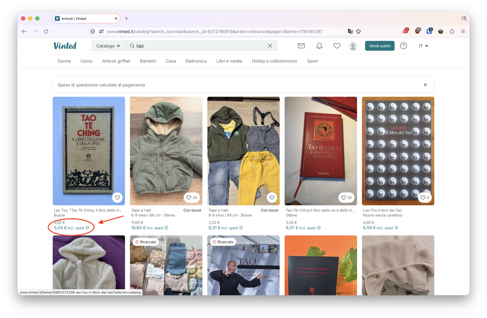

# Vinted Real Price

**See what you'll actually pay on Vinted — shipping included.**

Vinted shows the item price and the price "incl." Buyer Protection fee, but the shipping cost only appears after you open each item. Vinted Real Price is a userscript that replaces the "incl." price on every listing with the real total — **item + fee + cheapest shipping to you** — and adds a **"Real price"** option to Vinted's *Sort by* menu.



## Features

- **Real price on every card.** Search results, catalog, the home feed and other item grids on Vinted show the full price, labelled `incl. shipping`.
- **Breakdown on hover.** Hover a price to see e.g. `7,00 € item + 1,05 € fee + 2,29 € shipping (cheapest)`.
- **Sort by real price.** A new *Real price: low to high* entry in Vinted's own *Sort by* menu. It's off by default and turns off again as soon as you pick another sort option.
- **Item page too.** The price in the item sidebar shows the real total as well.
- **Free shipping and pickup-only** items are handled (`free shipping`, `pickup only`).
- **Localised UI.** English, Italian, French, German and Spanish; other languages fall back to English.

## Install

1. Install a userscript manager: [Tampermonkey](https://www.tampermonkey.net/) (Firefox, Chrome, Edge, Safari) or [Violentmonkey](https://violentmonkey.github.io/).
2. Click **[Install Vinted Real Price](https://github.com/r-carissimi/vinted-real-price/raw/main/vinted-real-price.user.js)** and confirm in the userscript manager.
3. Open or reload Vinted.

## How it works

When you click the "incl." price on Vinted, the price-breakdown popup loads its numbers from Vinted's own pricing endpoint:

```
https://api.edge.vinted.<tld>/pricing/public/api/v1/items/<item id>/services
```

The script calls the same endpoint for each visible item, from the page and with your Vinted session, so the shipping cost is the cheapest option for **your** address, including any shipping discounts. It then shows `total_amount + shipping.final_price`.

- Requests are limited to 6 at a time and cached for 30 minutes in `sessionStorage`. A page of ~100 items loads in well under a second.
- Nothing is sent anywhere except to Vinted itself. There is no tracking and no external server.
- Vinted renders the page with React, so the script doesn't edit Vinted's own elements. It hides them and shows a styled copy next to them. Sorting uses CSS `order` on the grid, so Vinted's infinite scroll and pagination keep working.

## Limitations

- **Sorting reorders the items on the current page only** (about 96 per page), not the whole search. Combine it with Vinted's *Price: low to high* to get the cheapest listings first, then sort them by real price.
- Shipping is the **cheapest available option**, the same "from" price Vinted shows. Your checkout total may be higher if you pick a pricier carrier.
- If Vinted can't calculate shipping to you, for example when an item can't ship to your country, the original Vinted price is left untouched.
- This relies on Vinted's internal, undocumented page structure and API. If Vinted changes them, the script may stop working until it's updated.
- Developed and tested on **vinted.it**. Other Vinted domains use the same structure and API but haven't been tested by a local buyer yet. [Reports are welcome](https://github.com/r-carissimi/vinted-real-price/issues).

## License

[MIT](LICENSE)

*Not affiliated with or endorsed by Vinted.*
